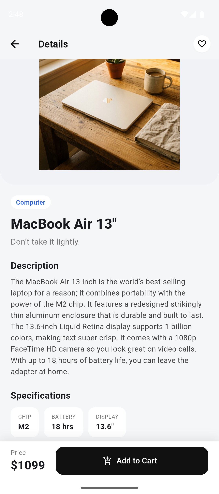
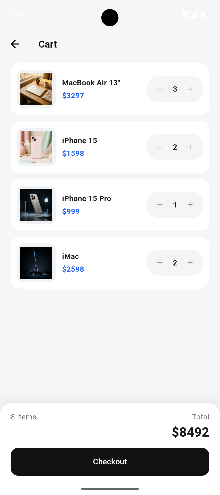
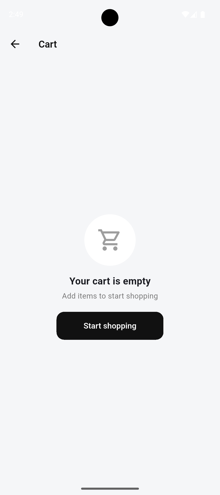

# Mini Katalog

Flutter eğitimi kapsamında geliştirilen, ürün listeleme, ürün detayı, favoriler ve sepet simülasyonu içeren basit bir mobil katalog uygulaması.

## Kısa Açıklama

Uygulama ürünleri bir API'den çeker. Kullanıcı ürünleri kategoriye göre filtreleyebilir, arayabilir ve sıralayabilir, bir ürünün detayına gidebilir, favorilerine ekleyebilir ve sepete atabilir. Sepette miktarı değiştirebilir, ürünü kaydırarak silebilir ve sipariş verme işlemini simüle edebilir. İnternet bağlantısı yoksa kullanıcıya bağlantıyı kontrol etmesini söyleyen bir ekran gösterilir ve "Try again" ile yeniden denenir.

## Özellikler

- Ana sayfa: banner, arama çubuğu, kategori çipleri ve `GridView` ile kart tabanlı ürün listesi
- Favoriler: kartta ve detayda kalp ikonu, "Favorites" çipi ile favori ürünleri filtreleme
- Sıralama: öne çıkanlar, fiyata göre artan/azalan ve isme göre
- Ürün detay sayfası: açıklama, özellikler, sabit fiyat ve sepete ekleme çubuğu, kart görselinden detaya Hero geçişi
- Sepet: miktar artır/azalt, kaydırarak silme, toplam tutar, boş sepet ekranı, checkout simülasyonu
- Sayfa geçişleri `Navigator` ve named routes ile yapılır, ürün bilgisi **Route Arguments** ile taşınır
- Ürün verisi `https://wantapi.com/products.php` adresinden `dart:io` `HttpClient` ve `dart:convert` ile çekilir.
- Model sınıfında `fromJson` / `toJson` bulunur. API'den metin olarak gelen fiyat (`"$2,499"`) sayıya çevrilir, kategori ürün adından türetilir
- Ürün görselleri `Image.network` ile yüklenir (yüklenirken gösterge, hata olursa yer tutucu ikon). Banner `Image.asset` ile projedeki dosyadan gösterilir
- Basit state yönetimi: `ChangeNotifier`

## Kullanılan Flutter Sürümü

Flutter 3.47.7

## Çalıştırma Adımları

```bash
git clone <https://github.com/MeryemTuzcu/mini_katalog>
cd mini_katalog
flutter create .
flutter pub get
flutter run
```

- `flutter create .` android/ios klasörlerini oluşturur, mevcut kodun üzerine yazmaz.
- Android emülatörü veya USB hata ayıklaması açık bir Android cihaz ve **internet bağlantısı** gerekir.
- Release APK için `android/app/src/main/AndroidManifest.xml` dosyasında şu izin tanımlı olmalıdır:
  `<uses-permission android:name="android.permission.INTERNET" />`
- Birden fazla cihaz varsa `flutter devices` ile listeleyip `flutter run -d <cihaz-id>` kullanılabilir.

## Klasör Yapısı

```
lib/
  main.dart
  theme/app_theme.dart
  models/product.dart
  data/product_repository.dart
  state/cart_state.dart
  state/favorites_state.dart
  screens/
    home_screen.dart
    product_detail_screen.dart
    cart_screen.dart
  widgets/
    product_card.dart
    product_image.dart
    favorite_button.dart
    cart_snackbar.dart
assets/
  images/banner.png
screenshots/
```

## Ekran Görüntüleri

| Ana sayfa | Ürün detayı |
| --- | --- |
|  |  |

| Sepet | Boş sepet |
| --- | --- |
|  |  |

## Notlar

- Ürün verileri ve görselleri, eğitim amaçlı sunulan wantapi.com sahte API'sinden gelir.
- Sipariş (checkout) işlemi simülasyondur, gerçek bir sipariş oluşturulmaz.
- Favoriler ve sepet bellekte tutulur, uygulama kapatılınca sıfırlanır.
